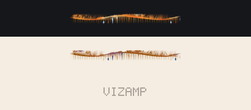

# Vizamp

Vizamp puts a live audio spectrum in your Omarchy bar. Peaks throw sparks, and the spectrum reshapes into the track title. Hover to see the title or click to play and pause. The colors follow your theme.



## Install

Use the stock bar on Omarchy 4.5 and a media player Omarchy already recognizes. The commands below build the audio helper from source.

```sh
omarchy pkg add gcc make pkgconf libpulse fftw
omarchy plugin add https://github.com/sliday/vizamp.git --yes
make -C "${HOME}/.config/omarchy/plugins/sliday.vizamp"
omarchy plugin enable sliday.vizamp
```

If you see `!` during playback, check that `make` succeeded and that PipeWire's PulseAudio server is running. Vizamp uses Omarchy's active player for the title and reads the default speaker mix for the spectrum.

## Update and remove

```sh
omarchy plugin update sliday.vizamp
make -C "${HOME}/.config/omarchy/plugins/sliday.vizamp"
```

To remove Vizamp, run `omarchy plugin remove sliday.vizamp`.

## Development

Run `make test` with Node.js and the build dependencies installed. Check the manifest with `omarchy plugin validate .`. Vizamp uses [FFTW](https://www.fftw.org/) and is licensed under [GPL-3.0-or-later](LICENSE).
