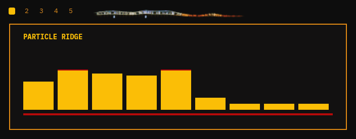

# Vizamp

Vizamp puts a live audio spectrum in your Omarchy bar. Peaks throw sparks, and the spectrum reshapes into the track title. The colors follow your theme.

- **Hover** for the title and track progress when your player provides it.
- **Drag the progress line** to seek when the player supports it.
- **Click** to play or pause. **Scroll up** for the previous track or **down** for the next.
- **Right-click** to cycle through the particle ridge, stacked bars, a scrolling spectrogram, and five rhythm lanes. Vizamp remembers your choice.
- **Shift + right-click** to toggle compact width. This is saved separately from the view.

The spectrogram shows bass at the bottom and recent audio at the right. Rhythm lanes turn sudden peaks into notes that travel toward the hit line. With reduced motion enabled, titles stay still, the spectrogram fills in place, and rhythm notes light up at the line.



[Watch the MP4](docs/vizamp-demo.mp4) · Recorded offscreen with sample audio levels.

## Install

Use the stock bar on Omarchy 4.5 and a media player Omarchy already recognizes. The commands below build the audio helper from source.

```sh
omarchy pkg add gcc make pkgconf libpulse fftw
omarchy plugin add https://github.com/sliday/vizamp.git --yes
make -C "${HOME}/.config/omarchy/plugins/sliday.vizamp"
omarchy plugin enable sliday.vizamp
```

If you see `!` during playback, check that `make` succeeded and that PipeWire's PulseAudio server is running. Vizamp uses Omarchy's active player for the title and reads the default speaker mix for the spectrum.

## Update and remove

```sh
omarchy plugin update sliday.vizamp
make -C "${HOME}/.config/omarchy/plugins/sliday.vizamp"
```

To remove Vizamp, run `omarchy plugin remove sliday.vizamp`.

## Development

Run `make test` with Node.js and the build dependencies installed. Check the manifest with `omarchy plugin validate .`. Vizamp uses [FFTW](https://www.fftw.org/) and is licensed under [GPL-3.0-or-later](LICENSE).
